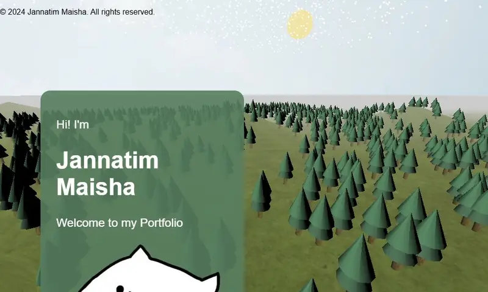

  

## Hi, I'm Jannatim 

**Ph.D. student in Computer Science** and Graduate Research Assistant at
[Georgia State University](https://www.gsu.edu/), Atlanta, in the **Body Data Interface (BDI) Lab**
with Dr. Yoon Jae Lee.

I work on **AI, machine learning, computer vision, NLP, multimodal learning and signal
processing**, and I'm increasingly drawn to **human–computer interaction**: turning signals
like attention, physiology and intent into intuitive, human-centered systems.

  

### 🔬 Current work
- **Contactless physiological sensing:** heart and breathing rate from camera rPPG fused with mmWave radar, applied to stress monitoring
- **Wearables:** fNIRS / PPG sensing and smartwatch interfaces
- **AI-assisted literacy coaching**
- **CareBot:** a GoPiGo3 medication-delivery robot that finds the patient with its camera, plans around obstacles, and is called from a Wear OS app

### 🧭 Background
- **Adjunct Lecturer**, Dept. of CSE, Southeast University, Dhaka (2024–2025)
- **B.Sc. in CSE**, Ahsanullah University of Science and Technology (AUST), 2024. Thesis on low-resource NLP for Bengali (contrastive and adversarial learning)
- Papers at ICCIT 2024, Informatics 2024, FMLDS 2024 and ICEEICT 2024 ([list](https://jannatim-maisha.github.io/publications/))
- Former competitive programmer (C++, Python)

### 📌 Selected projects
| Project | What it is | Stack |
|---|---|---|
| [Bangla singing-voice identification](https://github.com/jannatim-maisha/Softcom_lab_project) | Deep-learning singer identification from spectrograms of Bangla songs | Python, deep learning |
| [Helping Hand](https://github.com/jannatim-maisha/Helping-Hand) | Community, reward-driven service app | Kotlin, Android, Firebase |
| [AustPIC website](https://github.com/jannatim-maisha/AustPIC_official_main) | Website for the AUST programming club | ASP.NET Core 6, C#, SQL Server |
| [Step-by-step ML](https://github.com/jannatim-maisha/Step-by-Step-Machine-Learning) | Notebooks on encoding and linear regression | Python, scikit-learn, pandas |
| [Stockpile management](https://github.com/jannatim-maisha/customer-handling-and-stockpile-management) | Customer, stock, sales and invoice desktop system | Java Swing, SQL Server |
| [Pet health manager](https://github.com/jannatim-maisha/pet-health-manager) | Distributed database with fragmentation across sites | Oracle, PL/SQL |
| [Dead Block](https://github.com/jannatim-maisha/dead_block) | Top-down zombie shooter | C#, WinForms |

### 🛠️ Tools I use

  

### 🎬 Sneak peek: my 3D portfolio

  

Built with Three.js. Click to explore it live.

### 🐍 My contributions, eaten by a snake
<picture>
  <source media="(prefers-color-scheme: dark)" srcset="https://raw.githubusercontent.com/jannatim-maisha/jannatim-maisha/output/github-snake-dark.svg">
  <source media="(prefers-color-scheme: light)" srcset="https://raw.githubusercontent.com/jannatim-maisha/jannatim-maisha/output/github-snake.svg">
  
</picture>

---
*"Inspire before you expire."*
